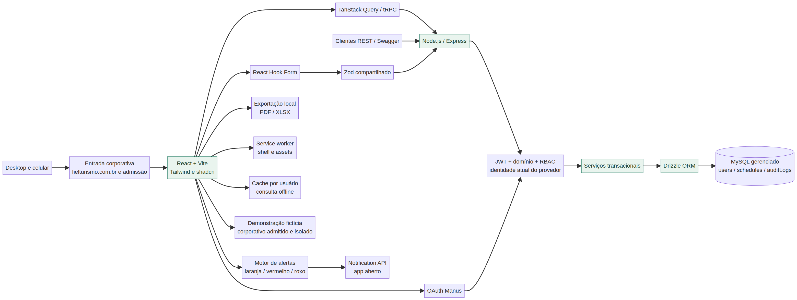
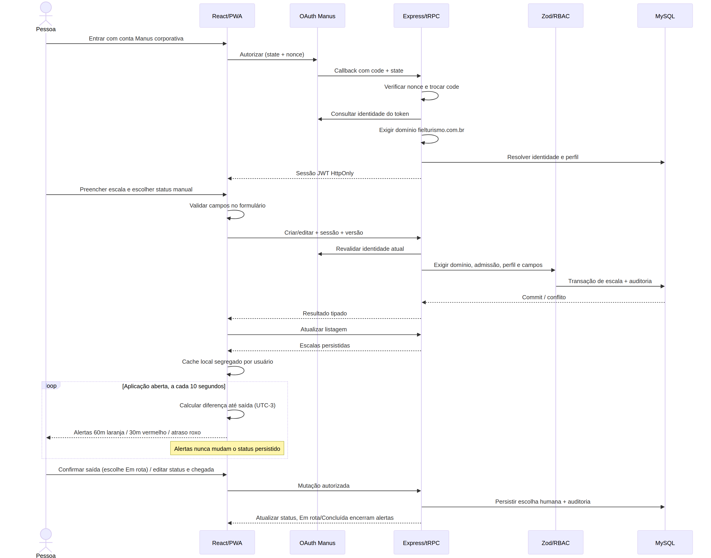
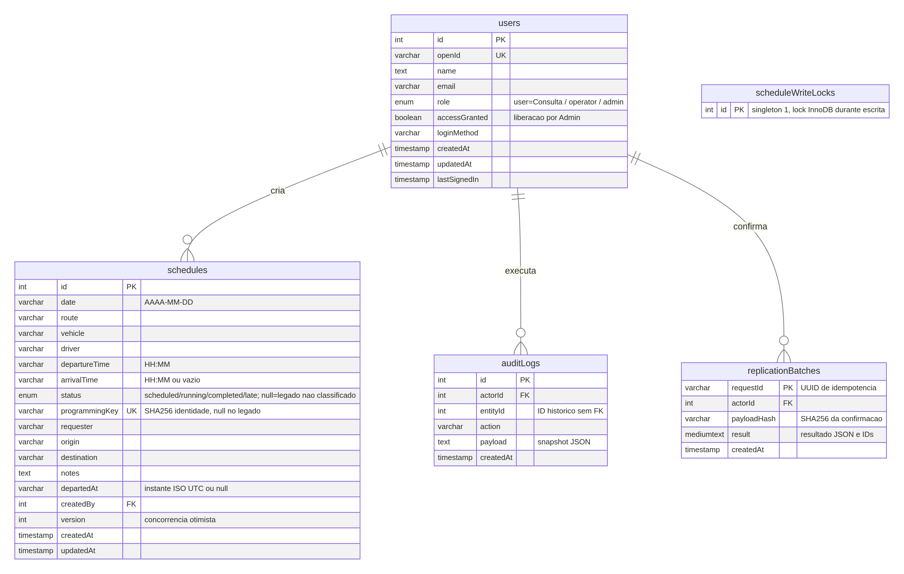
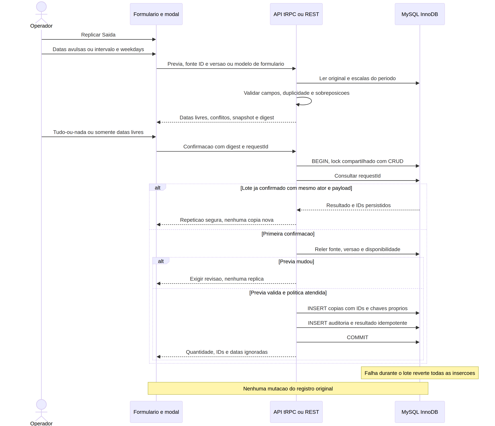

# Gestão de Escalas — Documento de Arquitetura

**Versão 1.3 · 14/10/2026 — login corporativo e replicação transacional**

Gestão de escalas de saída de veículos por rota, com acompanhamento preventivo em desktop e celular.

## 1. Visão da solução

A Gestão de Escalas é uma aplicação web responsiva com PWA instalável, CRUD de escalas, dashboard por dia/semana/mês, central de alertas, exportação PDF/Excel e controle de acesso. O frontend e a API são servidos pelo mesmo processo Node.js. O banco é persistente e independente do ciclo de vida do container.

A primeira tela é a **entrada corporativa**, com login por conta Manus associada a **@fielturismo.com.br**. Nenhum módulo ou demonstração é montado antes de uma identidade corporativa admitida. Após a liberação, a demonstração identificada continua isolada no navegador, sem ler ou escrever registros reais. Dados reais não são semeados com exemplos.

### Stack efetivamente utilizada

| Camada        | Implementação                                    | Decisão                                          |
| ------------- | ------------------------------------------------ | ------------------------------------------------ |
| Interface     | React 19, Vite 7, TypeScript estrito             | Interface responsiva e build de assets           |
| Design        | Tailwind CSS 4, componentes shadcn/Radix, Lucide | Formulários, diálogos acessíveis e navegação     |
| Formulários   | React Hook Form + Zod                            | Regras compartilhadas com servidor               |
| Estado remoto | TanStack Query + tRPC                            | Contratos tipados, invalidação e atualização     |
| API           | Node.js 22 + Express, tRPC e REST                | Monólito modular, uma origem HTTPS               |
| Banco         | MySQL gerenciado + Drizzle ORM                   | Persistência disponível na infraestrutura        |
| Identidade    | OAuth Manus + JWT HS256                          | Login real, sessão validada e perfis no banco    |
| Exportação    | jsPDF/AutoTable e ExcelJS                        | PDF A3 paisagem e arquivos .xlsx reais           |
| PWA           | Manifest próprio e service worker versionado     | Shell/assets offline; APIs não são cacheadas     |
| Qualidade     | Vitest, Playwright, TypeScript, Prettier         | Regras de domínio, RBAC e fluxos na demonstração |
| Deploy        | Container Node gerenciado                        | Frontend e backend integrados, healthcheck       |

PostgreSQL/Prisma, NestJS/Fastify, Vercel e Railway/Render/AWS eram recomendações iniciais. A implementação usa a infraestrutura integrada descrita no plano apresentado. Não afirma utilizar tecnologias ou serviços que não foram conectados.

## 2. Componentes

Os módulos de tela ficam em `client/src/pages`. O contexto operacional concentra integração com o servidor, demonstração, relógio, conectividade e cópia offline. Componentes de formulário, tabela e alertas são reutilizados pelas páginas. `shared/schedule.ts` concentra tipos, validação, períodos e regras de status. O servidor separa rotas, autenticação e serviços transacionais. O ORM contém o modelo físico e as migrações.

## 3. Fluxo de dados

O formulário é validado no navegador e novamente no servidor. Uma mutação exige sessão válida e perfil autorizado antes de acessar os serviços. Criação, alteração, confirmação de saída e exclusão geram registros de auditoria dentro da mesma transação. Após o commit, o frontend invalida e recarrega a listagem.

O cliente recalcula **somente alertas** a cada **10 segundos**. O status é escolhido pelo operador e persistido; nenhum relógio, horário de chegada ou timestamp o classifica automaticamente. Dados persistidos são reconsultados a cada **30 segundos** com a aplicação conectada e no modo real. Trata-se de atualização por polling, não de WebSocket nem de rastreamento GPS.

## 4. Modelo entidade-relacionamento

### Entidades e decisões

| Entidade             | Finalidade                                   | Chaves e restrições                                                                                                   |
| -------------------- | -------------------------------------------- | --------------------------------------------------------------------------------------------------------------------- |
| `users`              | Identidade, perfil e admissão                | `id` PK, `openId` único; role `admin`, `operator` ou `user`; `accessGranted` exige liberação para não administradores |
| `schedules`          | Dados manuais e andamento da viagem          | `id` PK, `createdBy` FK; índice composto `date, departureTime`; `version` para concorrência                           |
| `auditLogs`          | Histórico de mutações e alterações de perfil | `actorId` FK; `entityId` histórico sem FK para preservar auditoria de escalas excluídas                               |
| `replicationBatches` | Resultado idempotente de lotes               | requestId UUID PK, actorId FK, hash do payload e resultado mediumtext                                                 |
| `scheduleWriteLocks` | Coordenação de escritas concorrentes         | Linha singleton com lock InnoDB durante CRUD/lote                                                                     |

Rota, motorista, veículo, origem e destino são textos livres, conforme o pedido. Não há tabelas de cadastros auxiliares obrigatórios. Isso permite registro manual sem dependências prévias, mas não evita nomes duplicados ou divergências ortográficas. Uma evolução poderá introduzir catálogos opcionais sem remover os campos livres.

### Campos da escala

| Campo              | Persistência                            | Obrigatório      | Regra                                                                    |
| ------------------ | --------------------------------------- | ---------------- | ------------------------------------------------------------------------ |
| Data               | Texto `AAAA-MM-DD`                      | Sim              | Data existente; interface pt-BR; relatórios DD/MM/AAAA                   |
| Rota               | Texto até 160 caracteres                | Sim              | Livre, sem espaços vazios                                                |
| Veículo            | Texto até 160 caracteres                | Sim              | Prefixo informado manualmente                                            |
| Motorista          | Texto até 160 caracteres                | Sim              | Nome informado manualmente                                               |
| Horário de saída   | Texto HH:MM                             | Sim              | 00:00–23:59                                                              |
| Horário de chegada | Texto HH:MM ou vazio                    | Não              | Preenchido no retorno                                                    |
| Status da viagem   | Enum `scheduled/running/completed/late` | Sim na aplicação | Escolha explícita obrigatória do operador; legado `null` aguarda revisão |
| Solicitante        | Texto até 160 caracteres                | Sim              | Nome de quem solicitou                                                   |
| Origem / Destino   | Texto até 160 caracteres cada           | Sim              | Partida e chegada                                                        |
| Observações        | Texto até 2.000 caracteres              | Não              | Conteúdo livre                                                           |
| Saída real         | Instante ISO em UTC ou `null`           | Automático       | Criado ao confirmar saída                                                |
| Versão             | Inteiro positivo                        | Automático       | Incrementado em alteração/saída                                          |

**Retornos após meia-noite:** chegada representa apenas HH:MM, como solicitado. Não há duração real ou data de retorno medida. Exclusivamente para disponibilidade na replicação, chegada anterior/igual à saída ocupa até o dia seguinte, sem alterar campos. Para medir duração noturna com precisão, uma evolução deve incluir data/hora real de chegada.

## 5. Estados e alertas

| Estado           | Classificação                                                  |
| ---------------- | -------------------------------------------------------------- |
| Programada       | Operador seleciona Programada no formulário                    |
| Em rota          | Operador seleciona Em rota ou confirma explicitamente a saída  |
| Concluída        | Operador seleciona Concluída no formulário                     |
| Atrasada         | Operador seleciona Atrasada no formulário                      |
| Não classificada | Registro legado sem escolha humana persistida; aguarda revisão |

O formulário exige seleção, sem valor presumido. **Chegada preenchida não conclui a viagem**, inclusive antes da saída; horário passado não a classifica como Atrasada. A ação Confirmar saída esclarece que o humano escolhe Em rota e registra o instante real. Mudanças de status e confirmação geram auditoria transacional com ator e valores. A migração aditiva `0003` não infere status para os registros anteriores; mantém todos os dados e adiciona coluna nullable. O operador revisa o legado pela edição. Isso também se aplica a cópias locais antigas sem status. Não existe sensor ou prova automática de retorno nesta versão.

A prioridade dos alertas segue a diferença entre horário planejado e relógio atual, no fuso **America/Sao_Paulo / Brasília (UTC−3)**.

| Alerta               | Janela                               | Cor solicitada | Identificação adicional                      |
| -------------------- | ------------------------------------ | -------------- | -------------------------------------------- |
| Preventivo de 60 min | Mais de 30 e até 60 minutos          | **Laranja**    | Ícone de relógio, rótulo e minutos restantes |
| Preventivo de 30 min | A partir de 1 e até 30 minutos       | **Vermelho**   | Ícone, rótulo e contagem                     |
| Hora de sair         | Último minuto até o horário exato    | Vermelho       | Rótulo “Hora de sair” e “Agora”              |
| Saída atrasada       | Após o horário, sem saída confirmada | **Roxo**       | Triângulo de atenção e minutos de atraso     |

Os níveis são exclusivos: ao entrar na janela de 30 minutos, o aviso de 60 minutos é substituído pelo vermelho. **Alertas e status são conceitos separados**: um alerta roxo não altera a classificação da viagem. Avisos se aplicam a Programada, Atrasada e Não classificada; são encerrados quando o humano escolhe Em rota ou Concluída. Chegada informada isoladamente não suprime os alertas. Não se presume que o veículo saiu apenas porque o horário foi atingido.

Notificações do navegador são opcionais, exigem permissão e **a aplicação aberta**. A deduplicação ocorre por usuário/modo, escala, data, horário e nível durante a sessão do navegador. Não há serviço de push, e-mail, SMS ou WhatsApp com o app fechado.

## 6. Autenticação, autorização e segurança

O login utiliza OAuth real. O início cria um nonce curto e o associa ao `state`; o callback verifica essa associação antes de trocar o código. A sessão `webdev_app_session` é HttpOnly e compatível com HTTPS/Preview (`SameSite=None; Secure`). O JWT é verificado com HS256, expiração obrigatória e identificação do projeto. O cabeçalho Bearer também é aceito quando a política de cookies do navegador impede cookies no iframe.

**Domínio obrigatório:** somente o domínio exato `fielturismo.com.br`, sem subdomínios/endereço ausente/inválido ou sufixos parecidos. A origem do e-mail é a identidade do provedor após autenticação; não se confia em campo digitado ou claim arbitrário de e-mail. O contrato não expõe `emailVerified`, portanto essa informação não é inventada. O callback nega identidades externas antes de gravar usuário ou emitir sessão. Cada requisição autenticada reconsulta a identidade no provedor, confere o usuário e domínio, e falha fechado se a validação não estiver disponível. A vinculação ao projeto usa appId obrigatório do JWT assinado, clientId na troca OAuth e projectId na requisição de identidade; quando a resposta inclui projectId, ele é comparado estritamente, inclusive rejeitando valor vazio. Não se exige campo ausente do contrato atual do provedor. Middleware protege REST/tRPC inclusive Admin, sessões anteriores e administração de perfis. O Admin não pode liberar identidades externas. Usuários/roles legados não são removidos: tornam-se inelegíveis enquanto estiverem fora do domínio.

`CorporateAccessGate` precede todas as páginas e a demonstração. A sessão é atualizada ao voltar ao app e a cada 30 segundos com conexão. Rejeição de sessão/perfil durante uso fecha os módulos e limpa queries/cópias locais; um erro de domínio não inicia loop de revalidação. Consulte [o guia de login corporativo](login-corporativo.md) para o fluxo de colaboradores e administração.

Falha temporária de validação possui estado separado e erro 5xx: bloqueia acesso online e oferece nova tentativa, sem apagar o cache corporativo previamente autorizado. Metadados de identidade desnecessários (`manus-runtime-user-info`) não são mais gravados e os legados são removidos. O bootstrap do Admin usa transação e singleton InnoDB `scheduleWriteLocks` já existente para serializar checagem/promoção e impedir duas identidades concorrentes de assumirem o e-mail administrativo configurado; não requer migração adicional.

| Perfil   | Escalas e alertas | PDF / Excel | Criar / editar / excluir / confirmar | Gerenciar perfis |
| -------- | ----------------- | ----------- | ------------------------------------ | ---------------- |
| Admin    | Sim               | Sim         | Sim                                  | Sim              |
| Operador | Sim               | Sim         | Sim                                  | Não              |
| Consulta | Sim               | Sim         | Não                                  | Não              |

A conta administradora inicial é definida explicitamente pelo proprietário em `ADMIN_EMAIL`, usando o e-mail da conta Manus. Não se promove o primeiro visitante. A identidade configurada recebe Admin após login e resolução da sessão; a configuração não substitui um administrador existente por outra pessoa. Novas identidades recebem Consulta (`user`) **aguardando liberação**, sem acesso às escalas. O Admin autoriza um usuário selecionando Operador ou Consulta após o primeiro login. A interface não permite alterar o proprietário nem atribuir Admin a outros usuários. A API aplica admissão e perfil; esconder botões não é o mecanismo de segurança.

As escalas são compartilhadas apenas entre usuários admitidos desta aplicação e o administrador. Um login novo no endereço público não obtém acesso aos dados reais. **Não existe multitenancy, isolamento por filial ou revogação de ingresso pela interface nesta versão.** Para dados confidenciais, também restringir a visibilidade do projeto a pessoas autorizadas e aplicar políticas do dispositivo. A autenticação sozinha não equivale à admissão numa equipe.

Credenciais do banco e segredos de assinatura permanecem no servidor; não são inseridos no bundle. Respostas da API não têm cache compartilhado. Conteúdo livre é renderizado como texto pelo React, sem HTML fornecido pelo usuário. Mutações REST e tRPC, inclusive logout, exigem JSON e `X-RotaCerta-Request: 1`. Sem CORS, esse header não simples bloqueia requisições de formulários cross-site e impede o preflight de páginas de outra origem. O callback OAuth continua protegido por nonce/state.

## 7. PWA e funcionamento offline

O manifest define instalação standalone, nome, tema e ícones 192/512. No build, o service worker recebe a lista de assets com nomes versionados. APIs e autenticação não são armazenadas no cache HTTP do service worker. O frontend mantém uma cópia das últimas escalas carregadas, segregada por usuário e janela temporal, para consulta no mesmo navegador.

A leitura offline exige identidade corporativa anteriormente admitida; cópias de identidades externas/sem admissão não são liberadas e são limpas. Sem conexão não há revalidação de mudanças posteriores no provedor ou no perfil: a proteção do dispositivo e logout continuam necessários.

Não há fila offline nem sincronização posterior: gravações reais precisam de rede e autorização. Logout limpa imediatamente a cópia local e remove/cancela queries de escalas e equipe, mesmo sem rede. Uma saída remota pendente é registrada e precisa ser concluída antes de entrar novamente. A cópia local não é criptografada; dispositivos compartilhados exigem logout e políticas de proteção do dispositivo.

O service worker é habilitado **apenas em produção**, não no servidor Vite de desenvolvimento. A instalação pode depender de critérios do navegador. No iPhone, usar Safari → Compartilhar → Adicionar à Tela de Início.

## 8. API e persistência

O frontend usa tRPC; integrações externas podem usar REST com as mesmas regras de negócio. Documentação interativa em **`/api/docs`**, especificação em **`/api/openapi.json`**.

| Método | Endpoint                                       | Uso                                      |
| ------ | ---------------------------------------------- | ---------------------------------------- |
| GET    | `/api/health`                                  | Healthcheck público                      |
| GET    | `/api/session`                                 | Identidade autenticada                   |
| GET    | `/api/schedules?from=AAAA-MM-DD&to=AAAA-MM-DD` | Listagem por período                     |
| POST   | `/api/schedules`                               | Criar escala com os campos do formulário |
| PUT    | `/api/schedules/:id`                           | Alterar, body `{version, data}`          |
| POST   | `/api/schedules/:id/depart`                    | Confirmar saída, body `{version}`        |
| DELETE | `/api/schedules/:id`                           | Excluir, body `{version}`                |

Edição usa bloqueio de linha transacional e comparação de versão. Uma versão desatualizada retorna conflito, em vez de sobrescrever mudanças concorrentes silenciosamente. A interface orienta atualizar os dados e tentar novamente.

As migrações são versionadas em `drizzle/`. Foram aplicadas a migração inicial, escalas/auditoria/perfil Operador, admissão de equipe, status manual nullable (`0003`), programação única/lock/lotes (`0004`) e expansão de resultado para mediumtext (`0005`). O legado não foi removido nem reclassificado. Banco de desenvolvimento e publicado são o mesmo: unitários/E2E usam mocks/demonstração; a integração MySQL específica usa transação com rollback obrigatório, sem fixtures persistidas.

## 9. Escalabilidade e observabilidade

O monólito modular evita custo operacional de vários serviços para a primeira versão. A listagem de interface usa uma janela de três meses em torno da data selecionada e paginação local de **25 linhas por padrão, com opções de 50 e 100**. Alterar filtros ou tamanho reinicia a página; os contadores consideram somente registros filtrados. O índice temporal suporta o filtro no banco. Relatórios carregam bibliotecas pesadas sob demanda.

### Indicadores operacionais do dashboard

`shared/analytics.ts` centraliza cálculos do período Dia/Semana/Mês. A distribuição de status conta somente escolhas humanas (legado aparece separadamente). O ranking mostra as cinco rotas com mais escalas, não número de passageiros ou quilômetros. Veículos e motoristas são distintos por texto nas escalas selecionadas, sem cadastro da capacidade total. **Pontualidade** = saídas reais no horário ou antes / saídas com timestamp real válido. **Atraso médio observado** = soma dos atrasos positivos / quantidade de saídas reais atrasadas. Sem base, mostra “—”. Viagens sem saída real não entram nos denominadores. Prioridades contam alertas temporais, não status Atrasada. Os cálculos não medem ocupação, disponibilidade global da frota, GPS ou duração de viagens.

Para volume elevado, os próximos passos são paginação/busca no servidor, limitação de períodos da API, cache por escopo de organização, índices adicionais após medição, trabalhadores de push e arquitetura de admissão/multitenancy. A paginação atual não significa paginação de banco; não há promessa de desempenho para volumes não medidos.

Existe boundary de erro no React, logs do servidor e healthcheck. **Sentry e Logtail não estão configurados** sem os respectivos projetos/DSNs. Um pipeline de referência em `.github/workflows/ci.yml` executa tipagem, testes e build quando o código for hospedado em GitHub; sua presença não significa que foi executado num repositório GitHub conectado.

## 10. Qualidade e verificação

A tipagem estrita, lint sem avisos e build passaram. Nesta revisão foram aprovados **95 testes Vitest** (89 na suíte e seis testes adicionais de persistência/auditoria com banco simulado), incluindo status exclusivamente humano, chegada antecipada sem conclusão, relógio sem reclassificação, status obrigatório no backend, denominadores dos indicadores, RBAC, admissão, anti-CSRF e JWT. **13 cenários Playwright** foram aprovados contra o build de produção: quatro regressões novas (chegada futura/relógio/escolha persistida, status obrigatório e legado, paginação 25/50/100, indicadores/alertas independentes), cores, CRUD, downloads PDF/XLSX, quatro viewports 320/768/1024/1440, API sem autenticação e offline PWA. Dois cenários de privacidade anteriores permanecem no projeto, sem alterações nos módulos de autenticação. A revisão independente somente leitura não apontou falha bloqueante; a descrição OpenAPI de chegada foi alinhada ao regex validado pelo backend.

O fluxo OAuth com uma conta real não é simulado pelos E2E: os testes de sessão verificam assinatura/expiração/projeto e os E2E operam no modo demonstração ou com respostas interceptadas exclusivamente no teste. A validação manual de login/callback na URL publicada depende da conta do usuário e das políticas de cookies/redirect do navegador. O offline foi validado contra o servidor local de produção: após carregar escalas, retirar a conexão e recarregar a página, os registros permaneceram disponíveis e o cadastro ficou desabilitado.

## 11. Operação e entrega

`pnpm dev` inicia desenvolvimento. `pnpm check` valida tipos. `pnpm test` executa Vitest. `pnpm test:e2e` executa Playwright. `pnpm build` gera frontend, precache PWA e servidor; `pnpm start` serve produção. `pnpm db:migrate` aplica as migrações versionadas. Consulte `README.md` para o guia operacional e variáveis exigidas, sem valores de credenciais.

Na revisão de replicação, **138 unitários** foram aprovados, incluindo regras de datas/conflitos, rollback simulado, idempotência, concorrência, RBAC e integração com os serviços. **13 fluxos E2E** foram aprovados: nove específicos da replicação, regressão de CRUD e três testes do modo autenticado com transporte interceptado somente no teste. Estes verificam envio de fonte/datas/digest/UUID à API, invalidação da confirmação após fonte alterada e nova revisão após mudança de disponibilidade. Os demais cobrem cópias literais, avulsas/intervalo, cancelamento, conflitos, draft, edição pendente, mobile 320/768 e REST sem sessão. A integração MySQL real com rollback foi aprovada e confirmou zero registros de teste persistidos. Não se afirma E2E com login OAuth real ou escrita HTTP real de fixtures. A revisão independente apontou a prévia obsoleta; foi corrigida e os testes afetados passaram. Verificações futuras devem preservar essa separação e nunca semear registros de demonstração no banco real.

A versão é salva no repositório gerenciado antes da publicação. O container honra `PORT`, escuta em `0.0.0.0` e expõe `/api/health`. O documento descreve o software implementado; prévia e publicação são estados distintos e a URL definitiva é informada somente após confirmação do deploy.

## 12. Replicação de saídas

O botão **Replicar Saída** fica junto a Salvar/Registrar no formulário. O diálogo permite datas individuais ou intervalo inclusivo filtrado por dias da semana (até 366 datas por lote). Antes de confirmar, solicita uma prévia ao backend e mostra datas livres, duplicidades e conflitos de veículo/motorista. Em registro salvo, alterações não salvas precisam ser salvas ou descartadas: a fonte é carregada diretamente do banco por ID/versão, sem salvamento implícito. No novo cadastro, os campos validados são um modelo e a data original não é gravada automaticamente.

As réplicas mantêm literalmente todos os campos de domínio: rota, veículo, motorista, saída, chegada, solicitante, origem, destino, observações, status manual (inclusive null de legado) e saída real, quando registrada. **Somente a data da programação muda.** Não se reinicia status para Programada nem se apagam horários ou evidência de saída. Cada registro recebe ID, autoria de criação, versão inicial e timestamps técnicos próprios. O original não é atualizado. A prévia oferece a conferência de todos os campos preservados.

Identidade de programação = data + rota + veículo + motorista + saída HH:MM. Prefixos/nomes/rota são normalizados apenas para comparação (Unicode NFKC, espaços e caixa); os valores copiados não são transformados. Duplicidade é rejeitada mesmo se observações, status ou chegada divergem. `programmingKey` SHA-256 tem índice único para novas programações. O legado mantém chave null, sem remoção/backfill; o backend compara também os registros antigos. Cadastro e alteração de programação participam dessa proteção, sem modificar silenciosamente registros existentes.

Disponibilidade utiliza intervalos planejados nas escalas cadastradas: veículos ou motoristas iguais não podem ocupar períodos sobrepostos. Intervalos adjacentes são aceitos. Para análise de conflito, chegada anterior ou igual à saída indica ocupação até o dia seguinte; horários armazenados não são modificados. A regra de chegada vazia aguarda a decisão de negócio solicitada ao usuário. Não existe verificação externa de férias, manutenção, GPS ou identificação cadastral de recursos; grafias diferentes podem representar a mesma pessoa e exigem padronização operacional.

A confirmação exige Admin/Operador admitido e conectividade. Tudo-ou-nada não insere registros se houver conflito; “somente datas livres” grava apenas os elegíveis e informa as demais datas/motivos. A transação usa lock InnoDB de uma linha de coordenação, compartilhado por CRUD e lotes, para que escritas concorrentes não atravessem a checagem. A versão da fonte e o digest da prévia são revalidados dentro da transação; mudança relevante devolve `requiresReview` e nenhuma réplica, exigindo nova conferência. Cópias, auditoria individual e resultado do lote são confirmados juntos. Falha provoca rollback de todo o lote, sem persistência parcial.

A consulta de conflitos usa somente as datas escolhidas e os dias adjacentes (para ocupação noturna), sobre o índice temporal, em vez de ler todos os anos entre datas avulsas distantes. Inserts de cópias e auditorias são executados em lote. O lock global serializa escritas da aplicação e é adequado ao escopo atual; para volume elevado, evoluir para locks por recurso/dia sem perder a validação de intervalos. Escritores externos ou versões antigas que ignorem esse contrato podem introduzir sobreposições; o índice único continua protegendo a identidade da programação.

`replicationBatches` guarda requestId UUID, ator, hash do payload e resultado/IDs. Repetir a mesma confirmação retorna os IDs anteriores, sem cópias novas; outro ator ou outro payload com o mesmo UUID é rejeitado. A chave única é uma segunda barreira no MySQL. Erros encapsulados pelo ORM são reconhecidos para devolver conflito, sem sobrescrever registros. O resultado JSON é mediumtext para suportar lotes extensos.

REST: **POST `/api/schedules/replication/preview`** e **POST `/api/schedules/replicate`**, com os mesmos procedimentos tRPC validados, proteção de sessão/admissão/perfil e header anti-CSRF. O corpo identifica a fonte `{kind:"saved",id,version}` ou `{kind:"draft",data}`, seleção individual ou de intervalo, e, na confirmação, policy, requestId e previewDigest. Consulte a especificação interativa para formatos exatos.

**Integração no MySQL real:** `pnpm test:replication:db` abre uma transação, insere fixtures temporárias com identidade aleatória, executa o mesmo serviço de replicação, verifica cópia literal, IDs, original intocado, replay idempotente, índice único, políticas de lote e auditoria, e provoca rollback obrigatório. A verificação aprovada confirmou que usuários, escalas, auditorias e batch de teste não ficaram persistidos. Não é um seed nem uma simulação de persistência em localStorage. O modo demonstração continua explicitamente separado e usa as mesmas regras, sem acesso a registros reais.

## 13. Validação do login corporativo

Nesta alteração, **179 testes unitários** passaram: domínio exato, identidade atual do provedor, JWT/usuário/projeto, callback corporativo e nonce, exclusão de Admin externo, sessão antiga/claim arbitrário de e-mail, autorização de perfis e bootstrap transacional concorrente, além das regras operacionais existentes. **38 cenários E2E** passaram na primeira execução; o cenário PWA falhou por seu mock não conter e-mail corporativo e foi corrigido, sem relaxar a política. Os **10 cenários afetados finais** passaram (nove de login corporativo, incluindo indisponibilidade, e um de PWA offline). Os cenários corporativos anteriores aparecem também na primeira execução; não somar reexecuções como testes novos. Tipagem, lint sem avisos e build aprovados. Healthcheck público 200; API de escalas e identidade sem sessão rejeitadas com 401.

Revisão independente somente leitura identificou necessidade de distinguir indisponibilidade de sessão inválida, eliminar metadados locais desnecessários e serializar bootstrap; corrigidos com testes específicos. A observação de projectId obrigatório foi compatibilizada com o contrato real do provedor, que não garante essa propriedade na resposta GetUserInfo. Não foi realizado login OAuth com uma conta real nem promovido/modificado qualquer usuário real durante testes; validação do fluxo autenticado usa mocks de teste, não bypass em produção. A configuração administrativa foi verificada somente por resultado booleano, sem expor o e-mail protegido. A consulta somente leitura não encontrou Admin persistido no momento da verificação, portanto a conta explicitamente configurada precisa efetuar seu primeiro login para iniciar a liberação da equipe.
